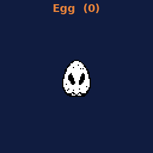
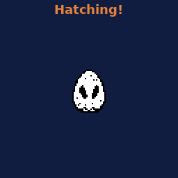
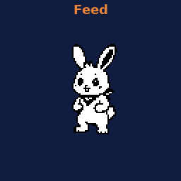
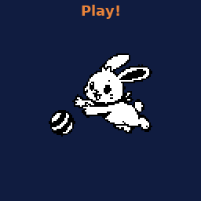
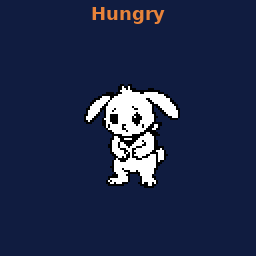
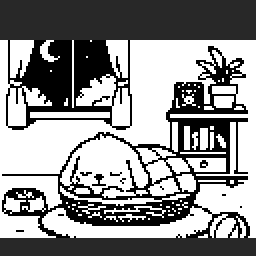
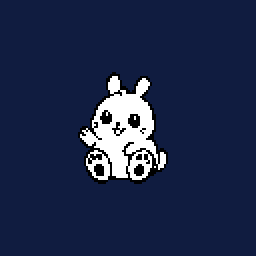

# 🐣 Pet rules: how your rabbit lives and grows

> Your rabbit grows when **you** focus. Finish focus sessions, and it gets carrots, energy and growth. Skip days, and it gets hungry, lonely or tired. **It never dies**, and it never shrinks back a stage.

📚 **All docs:** [🏠 README](../README.md) · [🛠️ Setup](setup.md) · **🐣 Pet rules** (you are here) · [🌐 Web page rules](webrules.md)

**Jump to:** [📊 Stats](#stats) · [🌱 Growth](#growth) · [🍅 Focus presets](#presets) · [🥕 Rewards](#rewards) · [🍽️ Care menu](#care) · [⏰ A day in the rabbit's life](#day) · [😟 Penalties](#penalties) · [🤒 Moods](#moods) · [🔥 Streak](#streak) · [🪔 Festival day](#festival) · [💤 Sleep](#sleep) · [🎬 Animations](#animations) · [💬 What it says](#speech) · [🔧 Change the numbers](#tune)

---

## 📊 The three stats

Each one goes from **0 to 100**. You can see them as bars at the bottom of the Home screen and on the [web page](webrules.md#pet).

| Stat | Meaning | Goes up with | Goes down with |
|---|---|---|---|
| 🍖 **Fullness** | how fed it is | 🥕 Feed | every daytime hour |
| ❤️ **Love** | how loved it feels | ✋ Pet, ⚽ Play | every 2 daytime hours, cancelling a focus |
| ⚡ **Energy** | how rested it is | ☕ full breaks, 🥕 Feed | ⚽ Play, skipping a break |

Bar colours on the web page: 🟢 above 60 · 🟠 30–60 · 🔴 below 30.

---

## 🌱 Growth and stages

| Stage | Growth points | Notes |
|---|:---:|---|
| 🥚 **Egg** | 0 | Hatches after your **first** finished 25/50 focus. Nothing can go wrong before it hatches. |
| 🐰 **Baby** | 1–9 | |
| 🐇 **Kid** | 10–39 | |
| 🧢 **Teen** | 40–99 | headband + backpack |
| 🏆 **Adult** | 100+ | fully grown |

| Event | Growth |
|---|:---:|
| Finished **25 min** focus | **+1** |
| Finished **50 min** focus | **+2** |
| Daily limit | **8 per day** at most |
| A day with **no** finished 25/50 focus | **−1** (see [Penalties](#penalties)) |

> 🛡️ **Stage floor:** a missed day can take Growth down only to the **start of the current stage** (Baby 1, Kid 10, Teen 40, Adult 100). It never un-hatches and never drops a stage.

When the rabbit reaches a new stage, Home plays a little stage-up show with a chime 🎉.

---

## 🍅 Focus presets

| Preset | How to start | Break after | Counts for the pet? |
|---|---|:---:|:---:|
| **25 min** | only from a **to-do** (To-do → OK) | 5 min | ✅ yes |
| **50 min** | only from a **to-do** | 10 min | ✅ yes |
| **10 min** quick focus | straight from Setup, no task | none | 🥕 1 carrot only |
| **1 / 2 min** test | straight from Setup, no task | none | ❌ no |

- Every **4th** finished 25/50 focus earns a **15 min long break** instead. The 4 dots on screen (●●●○) count up to it.
- When a break ends, Setup waits for you to press OK. The next focus never starts by itself.
- A focus cut by a reset or a power cut **resumes** when power comes back (at most ~1 min is lost).

---

## 🥕 Rewards

| You do | The rabbit gets |
|---|---|
| Finish a **25 min** focus | 🥕 **+1 carrot**, +1 Growth, today counts for the streak |
| Finish a **50 min** focus | 🥕🥕 **+2 carrots**, +2 Growth, today counts for the streak |
| Take the **full break** | ⚡ **+20 Energy** ("I feel rested!") |
| Finish a **10 min** quick focus | 🥕 **+1 carrot** only: no break, no Growth, no streak. It doesn't use up the 4-a-day limit |

- 🧺 It can hold up to **9 carrots**.
- 🎯 Carrots and break Energy are given for the **first 4** focus sessions of the day only. Later sessions still give Growth (up to 8 a day) and still count.
- ✅ Finishing a to-do on the device ("Task done?" → OK) plays a happy chime.

---

## 🍽️ Care menu (Home → OK)

 

Press **OK** on Home to open the menu, **MODE** to move, **OK** to do it, **BACK** to close. It closes itself after 10 s.

| Action | Effect | Rules |
|---|---|---|
| 🥕 **Feed** | uses 1 carrot → **+10 Fullness, +10 Energy** | needs a carrot · refused when Fullness and Energy are both 100 · not for the egg |
| ✋ **Pet** | **+10 Love** + floating heart ❤️ | **3 times a day** · refused at Love 100 |
| ⚽ **Play** | **+5 Love, −10 Energy**, plays with the ball | not while **Sick** · not under **20 Energy** |

Each action has its own sound: munch 🎵, happy 🎵, play 🎵.
The care menu is for free time only. **Breaks are rest time**, so the rabbit sleeps instead.

---

## ⏰ A day in the rabbit's life

| Time | What happens |
|---|---|
| 🌅 **8:00 am** | **Fresh day:** Fullness **50**, Love **60**, Energy **60**. "Good morning!" (If the device was off at 8, it happens at the next power-on that day.) |
| ☀️ **9 am – 11 pm, every hour** | Fullness drops (see the hunger table below) |
| ☀️ **10 am, 12 pm … 10 pm (every 2 h)** | Love **−5** |
| 🌙 **Midnight** | Streak check, missed-day check, daily counters reset, Worried clears, done to-dos leave the list |

### 🍖 Hunger table: focus more, get hungry less

| Rewarded focuses so far today | Fullness lost per hour |
|:---:|:---:|
| 0 | **−5** |
| 1 | **−4** |
| 2 | **−3** |
| 3 | **−2** |
| 4 or more | **0** 😌 not hungry any more |

> 🔌 Hours when the device was switched off still count (same day only), so turning it off doesn't freeze the rabbit.

---

## 😟 Gentle penalties

| Event | Effect |
|---|---|
| Cancel a focus in the **first 2 min** | nothing (grace period) |
| Cancel a focus **after 2 min** | ❤️ **−5 Love** ("Aww...") |
| **3** such cancels in one day | 😟 **Worried** until midnight |
| **Skip** a break | no Energy reward, and ⚡ **−5 Energy** ("I'm tired...") |
| A day with **no finished 25/50 focus** | 🔥 streak resets (a 🛡️ shield saves it once) **and** 🌱 **−1 Growth** (stage floor applies) |
| Fullness at **0** for **2 nights** | 🤒 **Sick** |

The **egg** and [festival days](#festival) skip all of these.

---

## 🤒 Moods and looks

**Home moods** follow Fullness and Love:

| Mood | When | Looks like | Text |
|---|---|---|---|
| 😢 Sad | Fullness **or** Love under **20** | sad, hungry face (every stage) | "I'm hungry / feed with task" ("OK = feed" when you hold a carrot) |
| 🙂 Calm | anything in between (20–49) | Baby/Kid look around and blink, Teen/Adult switch between idle and their signature pose | usual messages |
| 😊 Happy | Fullness **and** Love **50+** | cheering, arms up | "Keep Doing" |
| 🥰 Love | Fullness **and** Love **90+** | hugging a big heart + a red heart floating up ❤️ | "Love You Too" |

Since b9, every stage (Baby, Kid, Teen, Adult) has its own Sad, Happy and Love art. Only Calm animates; the other moods hold their face so you can read it at a glance. In Calm, Baby/Kid show the tired face when Energy is under 30. The web page's Pet card names the same mood (Hungry, Calm, Tired, Happy, In love, Sick, Worried). Other states:

| Mood | When | Looks like | Ends when |
|---|---|---|---|
| 😋 Hungry | Fullness under 30 (Baby, Kid) | droopy hungry face | you feed it |
| 😴 Tired | Energy under 30 (Baby, Kid) | lying down | a break or a feed |
| 😟 Worried | 3 late cancels in a day | "I'm worried..." | midnight |
| 🤒 Sick | Fullness 0 for 2 nights | **grey** rabbit, can't Play | **2 finished focuses** ("I feel better!") |

---

## 🔥 Streak and shield

- A day counts when you finish **at least one 25 or 50 min** focus.
- 🛡️ Every **7** streak days earns a **shield** (you can hold 1). It saves your streak for one missed day. The −1 Growth still happens.
- 🏅 Milestones: **3, 7, 30, 100** days (the rabbit cheers on screen).
- The [web page](webrules.md#streak) shows your current streak, best streak and the last 7 days ✅❌.

---

## 🪔 Festival day

Set it on the [web page](webrules.md#festival) (**Tomorrow is a festival**, or pick a date).

| On a festival day | |
|---|:---:|
| Hourly hunger and Love drops | ❌ off |
| Cancel and skip-break penalties | ❌ off |
| Streak break / −1 Growth for no focus | ❌ off |
| Sick night counting | ❌ off |
| Focus still gives rewards and Growth | ✅ yes |
| 8 am fresh start | ✅ still happens |

The next day continues normally, with your streak safe.

---

## 💤 Idle sleep

- After **1 hour** with no button press and no focus or break running, the rabbit falls asleep: a basket scene, animated **Zzz**, a dim screen and Wi-Fi off (saves power).
- **Any button** wakes it on the **Setup** screen. That waking press does nothing else.
- Wi-Fi and the clock come back within a few seconds.
- An open [web page](webrules.md) keeps it awake.

### 🕗 It knows the time (b10)

On Home only (never during a focus or break), once the clock is set:

| Time | What it does |
|---|---|
| 8:00–9:00 | first Home view of the day: **"Good morning!"** + an ear twitch (Baby/Kid) or its signature pose (Teen/Adult) |
| 13:00–14:00 | **"Lunch time?"** |
| 22:00–23:00 | Baby/Kid yawn (tired face) + **"Getting late / sleep soon?"** |
| 23:00–5:00 | **"So sleepy..."**, and after **2 minutes** with no button it goes to sleep (basket, Zzz, dim screen). A press wakes it as usual; it dozes off again 2 min later. |
| 8:00 | a night sleep **wakes by itself** on Home and says good morning |

A sad mood (hungry face) always wins over the time looks. The time text replaces "Keep Doing" / "Love You Too" in its hour. Serial key `h` previews the hours: real clock → 8 → 13 → 22 → 23 → real.

---

## 🎬 Animations

| When | Animation |
|---|---|
| Egg on Home | wobbles left and right 🥚 |
| First focus finished | egg cracks open → baby 🐣 |
| Baby / Kid idle | blinks 👀 and ear twitches every 3–8 s |
| Teen / Adult idle | signature pose |
| Feed | eating frame 🥕 |
| Pet | happy face + floating heart ❤️ |
| Play | bounces while playing with a ball ⚽ |
| Break | sleeping in the basket 😴 |
| Idle 1 hour | basket + Zzz, dim screen 💤 |
| Focus | animated hourglass ⏳ (+ minutes, unless you [turn them off](webrules.md#settings)) |

---

## 💬 What the rabbit says

| Message | When |
|---|---|
| "Good morning!" | first Home view 8–9 am (b10) |
| "Lunch time?" · "Getting late / sleep soon?" · "So sleepy..." | 1 pm · 10 pm · 11 pm–5 am (b10) |
| "Great focus! +carrot" / "+2 carrots" | finished 25 / 50 |
| "Great focus!" | finished, but the 4-a-day rewards are used up |
| "I feel rested!" | full break done |
| "Yum! Thank you!" · "I'm full!" · "No carrots yet" | Feed |
| "I'm hungry" / "feed with task" | sad mood (Fullness or Love under 20) |
| "Keep Doing" · "Love You Too" | happy / love mood |
| "Nice! +carrot" | finished a 10 min quick focus |
| "Hehe, I love you!" · "I'm so loved!" · "Pets again tomorrow" | Pet |
| "Wheee! So fun!" · "Too tired to play" · "Too sick to play" | Play |
| "Aww..." · "I'm worried..." | late cancel |
| "I'm tired..." | skipped break |
| "I feel better!" | cured |
| "Day 3 streak!" · "7 days! Shield won!" | milestones |
| "Festival - no worries" | cancel on a festival day |
| "Hatch me first!" | care menu while still an egg |

---

## 🔧 Change the numbers yourself

Every number above is in **one file**: `pomodoro_rabbit_v1/petrules.h`, at the top. Change it, then [upload again](setup.md#flash) (your pet's data stays).

| Constant | Default | Meaning |
|---|:---:|---|
| `FRESH_F`, `FRESH_L`, `FRESH_E` | 50, 60, 60 | the 8 am fresh-day stats |
| `HUNGER_TIER` | 5, 4, 3, 2, 0 | Fullness lost per hour by rewarded focuses |
| `DAY_START_H` | 8 | hour of the fresh day |
| `DAY_LOVE`, `DAY_LOVE_EVERY` | 5, 2 | Love lost, every N hours |
| `FEED_FULL`, `FEED_ENERGY` | 10, 10 | what one carrot gives |
| `BREAK_ENERGY` | 20 | full-break Energy |
| `PET_LOVE`, `PET_MAX` | 10, 3 | Pet Love, pets per day |
| `PLAY_LOVE`, `PLAY_ENERGY`, `PLAY_MIN_ENERGY` | 5, 10, 20 | Play rules |
| `REWARD_SESSIONS`, `GROWTH_CAP`, `CARROT_MAX` | 4, 8, 9 | daily reward limit, daily Growth cap, carrot bag |
| `MISS_GROWTH` | 1 | Growth lost for a missed day |
| `CANCEL_LOVE`, `WORRY_CANCELS`, `SKIP_ENERGY` | 5, 3, 5 | penalties |
| `CANCEL_GRACE_MS` | 120000 | the 2 min free-cancel window |
| `SICK_NIGHTS`, `CURE_SESSIONS` | 2, 2 | sick and cure rules |
| `QUICK_CARROTS` | 1 | carrots for a 10 min quick focus |
| `MOODF_SAD_BELOW`, `MOODF_HAPPY_AT`, `MOODF_LOVE_AT` | 20, 50, 90 | Home mood limits |

> A brand-new pet's very first stats come from `appdata.h` (`fullness = 50, energy = 60, love = 60`).

---

📚 **Next:** [🌐 Everything on the web page](webrules.md) · [🛠️ Build it yourself](setup.md) · [🏠 Back to README](../README.md)
