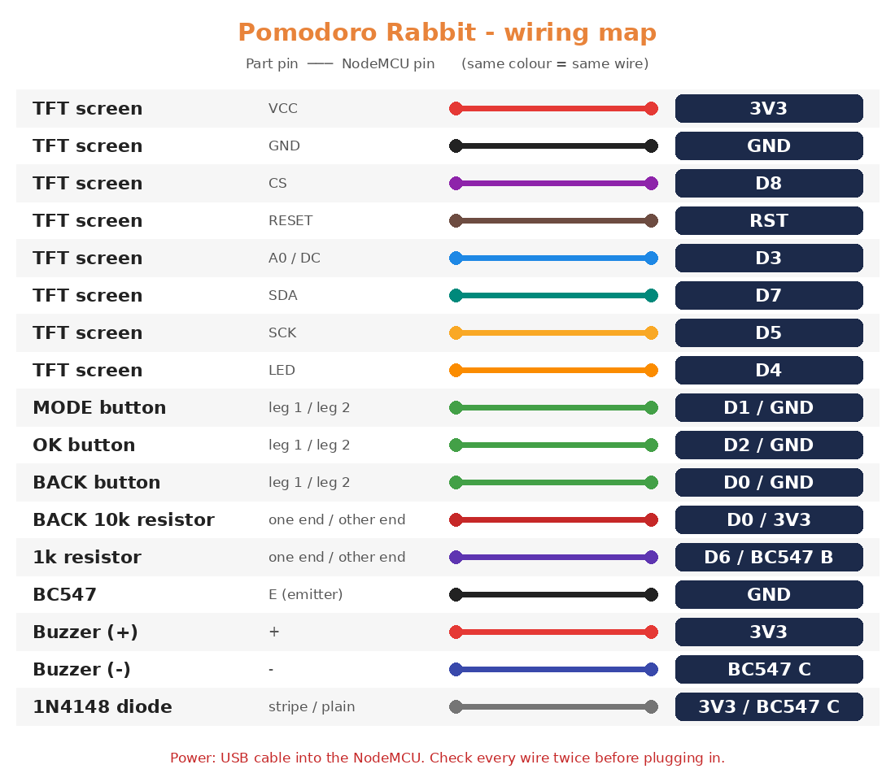

# 🛠️ Build your own Pomodoro Rabbit: setup guide

<p align="center"></p>

> **Who is this for?** Anyone. You don't need to know coding, electronics or IT. Follow the steps in order, tick each box, and you'll have a working rabbit timer on your desk.

📚 **All docs:** [🏠 README](../README.md) · **🛠️ Setup** (you are here) · [🐣 Pet rules](petrules.md) · [🌐 Web page rules](webrules.md)

---

## 🗺️ The whole journey

| Step | What you do | Time |
|:---:|---|:---:|
| 1️⃣ | [Buy the parts](#parts) | shopping |
| 2️⃣ | [Wire everything](#wiring) | ~45 min |
| 3️⃣ | [Install the free software](#software) | ~20 min |
| 4️⃣ | [Download this project](#download) | 2 min |
| 5️⃣ | [Flash (upload) the firmware](#flash) | ~5 min |
| 6️⃣ | [First boot + Wi-Fi](#wifi) | 5 min |
| 7️⃣ | [Use it every day](#daily) | 🍅 |
| 🆘 | [Something's wrong?](#troubleshooting) | |

---

<a id="parts"></a>

## 1️⃣ Buy the parts

You can find all of these at any electronics shop or online store (Robu, Amazon, etc.). Total is usually **under ₹600**.

| ✅ | Part | Qty | What it does |
|:---:|---|:---:|---|
| ☐ | **ESP8266 NodeMCU** (v2 or v3, 4 MB) | 1 | The brain 🧠 |
| ☐ | **1.8" ST7735 TFT screen, 128×160** (red board, "black tab") | 1 | The face 📺 |
| ☐ | **Passive buzzer** (3.3–5 V) | 1 | The voice 🔔 |
| ☐ | **BC547** transistor (or 2N2222) | 1 | Makes the buzzer louder |
| ☐ | **1 kΩ resistor** (brown-black-red) | 1 | For the transistor |
| ☐ | **10 kΩ resistor** (brown-black-orange) | 1 | For the BACK button |
| ☐ | **1N4148 diode** | 1 | Protects the transistor |
| ☐ | **Push buttons** (small 6×6 mm type) | 3 | MODE · OK · BACK |
| ☐ | **Breadboard** + **jumper wires** (male-to-female and male-to-male) | 1 set | No soldering needed |
| ☐ | **Micro-USB data cable** | 1 | Power + upload. ⚠️ Must be a *data* cable, not a charge-only one |

> 💡 **Passive vs active buzzer:** a passive buzzer has **no sticker** and you can see the green circuit board underneath it. An active buzzer only beeps one note, so the rabbit's music won't work.

---

<a id="wiring"></a>

## 2️⃣ Wire everything

⚠️ **Unplug the USB cable while you wire.** Plug it in only after you've checked every wire twice.

<p align="center"></p>

### 📺 Screen → NodeMCU

The pin names are printed on the back of the screen and on the NodeMCU.

| Screen pin | NodeMCU pin | Suggested wire colour |
|---|:---:|---|
| VCC | **3V3** | 🔴 red |
| GND | **GND** | ⚫ black |
| CS | **D8** | 🟣 purple |
| RESET (RST) | **RST** | 🟤 brown |
| A0 (sometimes "DC") | **D3** | 🔵 blue |
| SDA | **D7** | 🟢 green |
| SCK | **D5** | 🟡 yellow |
| LED | **D4** | 🟠 orange |

> ⚠️ **Never connect VCC and LED together.** If they touch, the screen flickers and shows noise.

### 🔘 Buttons → NodeMCU

A button has 4 legs. Put it across the middle gap of the breadboard, then use **two legs on opposite corners**.

| Button | One leg to | Other leg to | Extra |
|---|:---:|:---:|---|
| **MODE** | D1 | GND | nothing |
| **OK** | D2 | GND | nothing |
| **BACK** | D0 | GND | ⚠️ also a **10 kΩ resistor from D0 to 3V3** |

### 🔔 Buzzer circuit

The BC547 has 3 legs. Hold it with the **flat side facing you**: the legs from left to right are **C – B – E**.

| From | To |
|---|---|
| NodeMCU **D6** | 1 kΩ resistor → BC547 **B** (middle leg) |
| BC547 **E** (right leg) | **GND** |
| BC547 **C** (left leg) | buzzer **−** (short leg) |
| Buzzer **+** (long leg) | **3V3** (or **VIN** for a louder 5 V buzzer) |
| 1N4148 diode | across the buzzer: **stripe side to +**, plain side to − |

### ✅ Wiring checklist

- [ ] All 8 screen wires are connected
- [ ] 3 buttons go to D1, D2 and D0, and each also goes to GND
- [ ] The 10 kΩ resistor is between D0 and 3V3
- [ ] The buzzer circuit matches the table
- [ ] No bare metal wires touch each other

---

<a id="software"></a>

## 3️⃣ Install the free software

You do this once on your laptop (Windows, Mac or Linux).

1. **Download the Arduino IDE** from 👉 [arduino.cc/en/software](https://www.arduino.cc/en/software) and install it.
2. Open it, then go to **File → Preferences** (on Mac: **Arduino IDE → Settings**).
   In **"Additional boards manager URLs"**, paste:
   ```
   https://arduino.esp8266.com/stable/package_esp8266com_index.json
   ```
   Click **OK**.
3. Go to **Tools → Board → Boards Manager**, search **esp8266**, and install **"esp8266 by ESP8266 Community"** (version **3.1.2** is tested).
4. Go to **Tools → Manage Libraries**, then search for and install:
   - **Adafruit GFX Library**
   - **Adafruit ST7735 and ST7789 Library** (click **Install all** if it asks)
5. **USB driver** (only if your laptop doesn't see the board in step 5): look at the small chip near the USB port.
   - It says **CH340** → install the [CH340 driver](https://www.wch-ic.com/downloads/CH341SER_EXE.html)
   - It says **CP2102** → install the [CP210x driver](https://www.silabs.com/developers/usb-to-uart-bridge-vcp-drivers)

---

<a id="download"></a>

## 4️⃣ Download this project

1. At the top of this GitHub page, click the green **`<> Code`** button → **Download ZIP**.
   (Or open **Releases** on the right side and download the newest `pomodoro_rabbit_v1_bX.zip`.)
2. **Unzip** it. You'll see:
   ```
   README.md
   docs/                     ← these guides
   pomodoro_rabbit_v1/       ← the firmware (open this one)
   tools/
   ```
3. ⚠️ Don't rename the `pomodoro_rabbit_v1` folder. Arduino needs the folder name and the `.ino` file name to match.

---

<a id="flash"></a>

## 5️⃣ Flash (upload) the firmware

"Flashing" just means copying the program into the NodeMCU.

1. Plug the NodeMCU into your laptop with the USB cable.
2. In Arduino IDE: **File → Open** → `pomodoro_rabbit_v1/pomodoro_rabbit_v1.ino`.
3. Set the **Tools** menu exactly like this:

   | Tools setting | Choose |
   |---|---|
   | Board | **NodeMCU 1.0 (ESP-12E Module)** |
   | Port | the new **COM** port (Windows) or **/dev/cu.usbserial…** (Mac) |
   | Flash Size | **4MB (FS:2MB OTA:~1019KB)** |
   | Erase Flash | **Only Sketch** ⭐ (keeps your pet when you update later) |
   | Upload Speed | 115200 (safe) or 921600 (faster) |

4. Click the **➡️ Upload** button (the right arrow at the top left).
5. Wait for **"Done uploading"** at the bottom. It takes about 1 minute. 🎉

> 💡 Updating to a newer version later works the same way. With **Erase Flash = Only Sketch**, your rabbit, streak, to-dos and Wi-Fi stay safe.

---

<a id="wifi"></a>

## 6️⃣ First boot + Wi-Fi

1. The screen shows a **4-page welcome**. Press **OK** for the next page and **BACK** to go back.
2. The rabbit needs your Wi-Fi to know the time. If no Wi-Fi is saved yet, the device makes its own hotspot:
   - 📱 On your phone, join the Wi-Fi network **`Pomodoro-Setup`**
   - A setup page pops up by itself (if not, open **http://192.168.4.1** in your browser)
   - Tap your home Wi-Fi name, type the password, and save
3. The device joins your Wi-Fi and gets the time ⏰.
4. Press **BACK on the Home screen** to see the web address. On the same Wi-Fi, open **http://pomodoro.local** (or the IP number shown) on your phone or laptop → this is your [🌐 web page](webrules.md).

> 📡 The ESP8266 only works with **2.4 GHz** Wi-Fi, not 5 GHz. Most home routers have both.

---

<a id="daily"></a>

## 7️⃣ Use it every day

<p align="center"> </p>

### 🎮 The 3 buttons

| Button | Short press | Hold 1 s |
|---|---|---|
| **MODE** | go to the next screen / option | mute or unmute the focus sounds |
| **OK** | choose · start · pause | mark a to-do done (on the To-do screen) |
| **BACK** | go back · press **twice** to cancel a focus | |

### 🍅 A normal day

1. 📝 Add tasks on the [web page](webrules.md#todo).
2. On the device: **MODE** → Setup → **MODE** until **To-do** → pick a task with **BACK** → **OK**.
3. Choose **25** or **50** minutes with **MODE**, then press **OK** to start. The hourglass runs and a soft heartbeat plays 💓.
4. When it ends, the device asks **"Task done?"** → **OK** = yes, **BACK** = not yet.
5. Your break starts by itself ☕ (the rabbit sleeps).
6. Every finished focus gives the rabbit 🥕 carrots. Feed it from **Home → OK**.

> ⚡ Need a short one? **1, 2 and 10 min** start straight from Setup with no task. They give no rewards.

---

<a id="troubleshooting"></a>

## 🆘 Troubleshooting

| Problem | Fix |
|---|---|
| ❌ Laptop doesn't show any Port | Try a different USB cable (most are charge-only). Install the CH340/CP2102 driver from [step 3](#software). |
| ❌ "Failed to connect to ESP8266" | Choose Upload Speed **115200**. Hold the **FLASH** button on the NodeMCU while the upload starts. |
| ❌ "Adafruit_ST7735.h: No such file" | Install both Adafruit libraries ([step 3](#software)). |
| ⬛ Screen stays black / white | Check VCC→3V3, GND, CS→D8, A0→D3, and that **LED→D4** isn't touching VCC. |
| 🌈 Screen shows noise or wrong colours | VCC and LED are shorted, or SDA/SCK are swapped. |
| 🔘 BACK does nothing | The 10 kΩ resistor from **D0 to 3V3** is missing. |
| 🔇 No sound | Check you have a **passive** buzzer, check the transistor legs (C-B-E), and make sure focus sounds aren't muted (hold MODE). |
| 📶 Can't find `Pomodoro-Setup` | Wait 30 s after power-on. Change Wi-Fi from the [web page](webrules.md#settings) to reopen it. |
| 🌐 `pomodoro.local` won't open | Use the IP number shown on the device (Home → BACK). Make sure your phone is on the same Wi-Fi. |
| 🕐 Wrong time | The device needs internet once to get the time. It uses India time (IST). |

Still stuck? Open the **Serial Monitor** (magnifier icon at the top right of Arduino IDE), set it to **115200 baud**, type `?` and press Enter. Copy what it prints into a GitHub **Issue**.

---

📚 **Next:** [🐣 How the rabbit grows (pet rules)](petrules.md) · [🌐 Everything on the web page](webrules.md) · [🏠 Back to README](../README.md)
